# How Inky Keys grew

> The game was called **Inkling**, and its word creatures **Blotlings**, until 2026-11-15. The screenshots and notes below keep the names each version used.

Screenshots of Inky Keys at the end of every milestone, from the first moving blob to today. Each one comes from a real build of that milestone's commit, played in headless Chrome by `npm run snapshots` (see [Keeping this up to date](#keeping-this-up-to-date)).

The first half puts **the same screen side by side** across versions, so you can see what changed. The second half goes **milestone by milestone**, saying what each one added.

A note on the pictures: an auto-typer plays the pages, so the grades are all A+. The **lineup** shots are staged. They swap the creatures on screen for one of each kind (a drip, a Blotling, a crimson, a violet, a Run-on and a Misprint), so creature looks can be compared even in versions where those creatures only show up chapters later.

## Side by side

### Creatures on the page

| M1 | M2 | M3 |
|---|---|---|
|  | 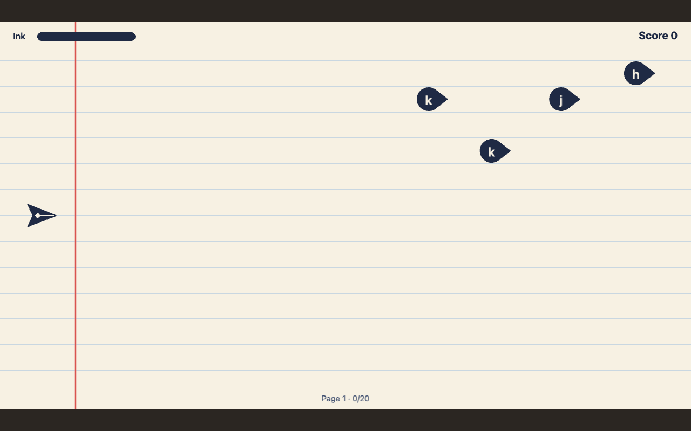 | 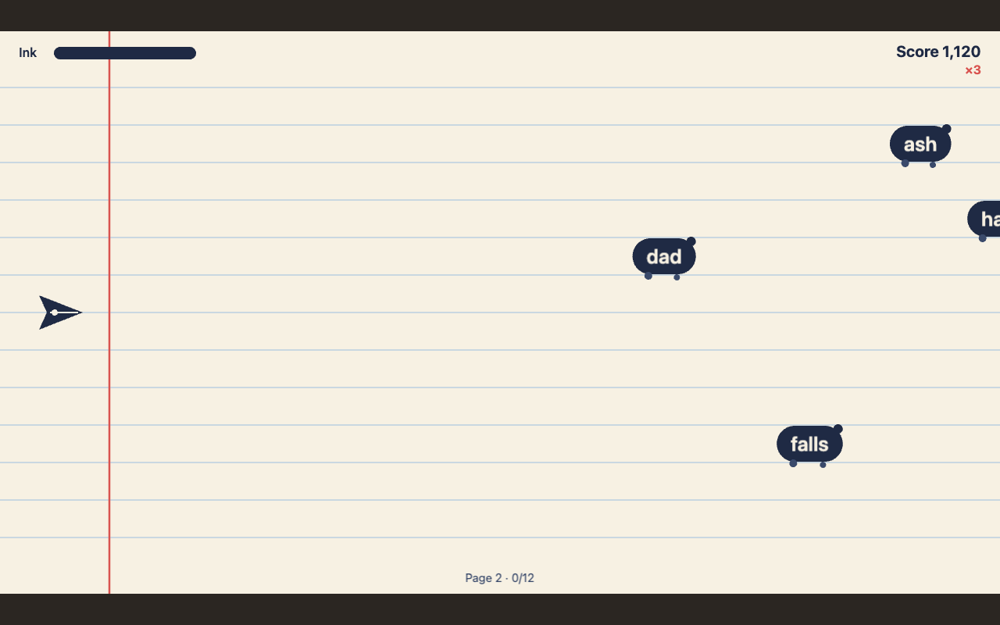 |
| One placeholder blob with a word. No typing yet. | **Drips:** letters to type, plus the ink bar and score. | **Blotlings:** real words built from your keys. |

| M8 | M11 | M14 and later |
|---|---|---|
|  |  |  |
| Run-ons and Misprints arrive, but every target is still a flat shape. | **Faces and bodies:** eyes, legs, a centipede Run-on, a stamp Misprint. Crimson and violet variants. | **Distinct variants:** crimson gets spikes and horns, violet a crown, a third eye and a wavy hem. |

### Font

| M9 | M10 |
|---|---|
| 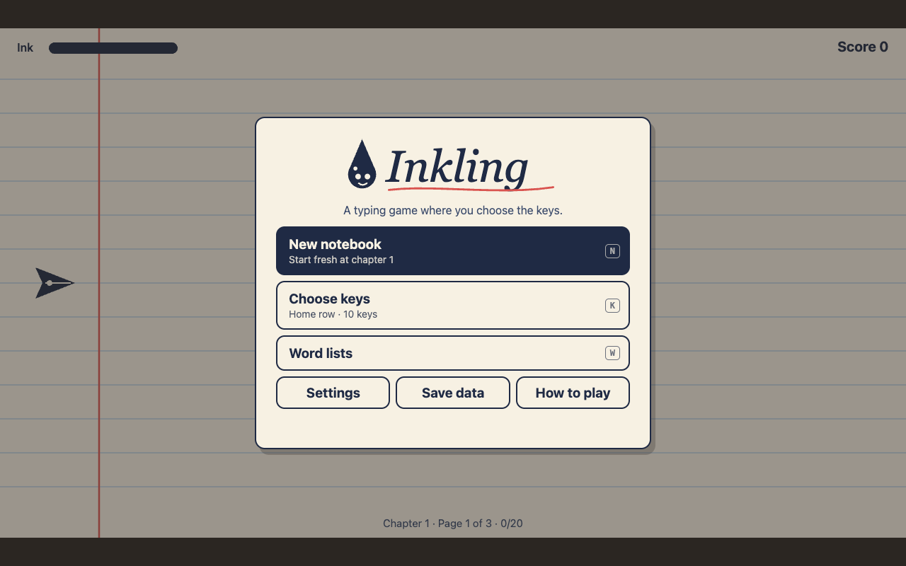 |  |
| System font. | **Atkinson Hyperlegible** everywhere, so `l I 1 \|` and `0 O` look different. |

### First screen

| M2 | M4 | M5 | M8 |
|---|---|---|---|
| 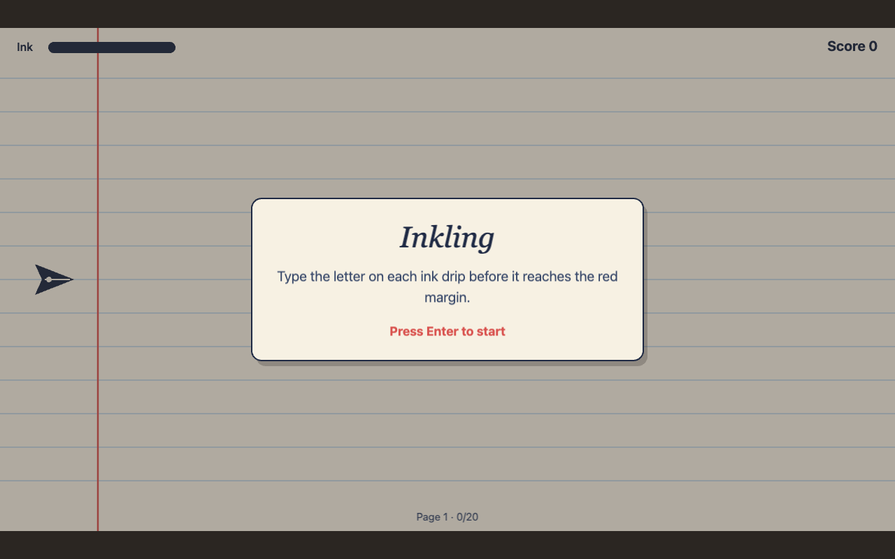 |  |  |  |
| "Press Enter to start". | **Difficulty** picker. | Shows **your keys**, with Change keys (K). | Shortcuts pile up: keys, word lists, saves, settings. |

| M9 | M12 | M13 | M14 | Latest |
|---|---|---|---|---|
|  | 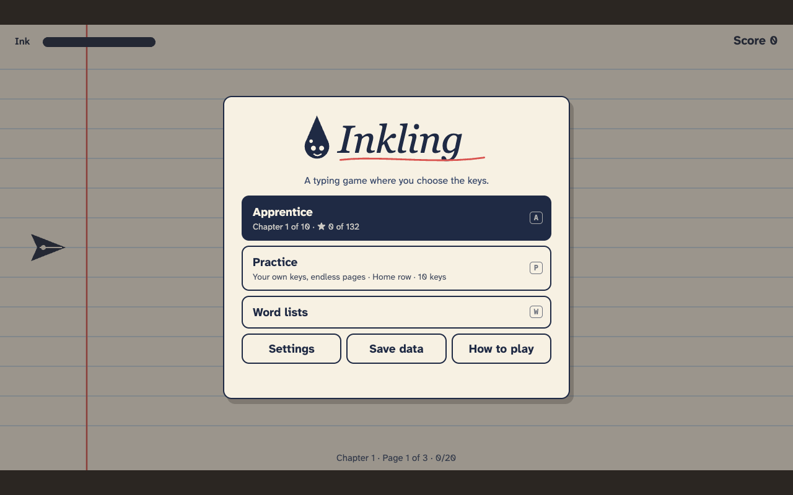 |  |  | 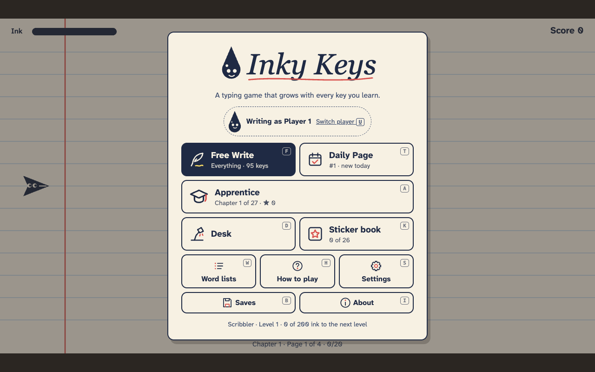 |
| A real **main menu** with a logo replaces the card. | **Apprentice** and **Practice** replace New notebook and Choose keys. | **Desk** button, and your rank and ink along the bottom. | **Player** badge and **About**. The course is now 27 chapters long. | **Free Write** (formerly Practice) comes first; new players start on letters, capitals and space. A **Daily Page** button (M20) and a **Sticker book** (M21). |

### Type Case (choosing keys)

| M5 | M7 | M10 | Latest |
|---|---|---|---|
|  | 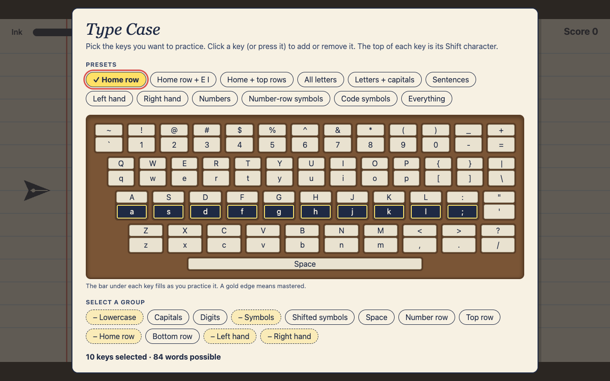 |  |  |
| Wooden keyboard with two-part keys, presets and groups. | **Mastery bars** under each key that fill as you practice. | New font. | **Typewriter:** black enamel, gold pinstripe, round chrome keys. A **My Apprentice keys** preset. |

### End of a page

| M2 | M7 | M12 | M13 | M15 | M17 | M20 |
|---|---|---|---|---|---|---|
|  | 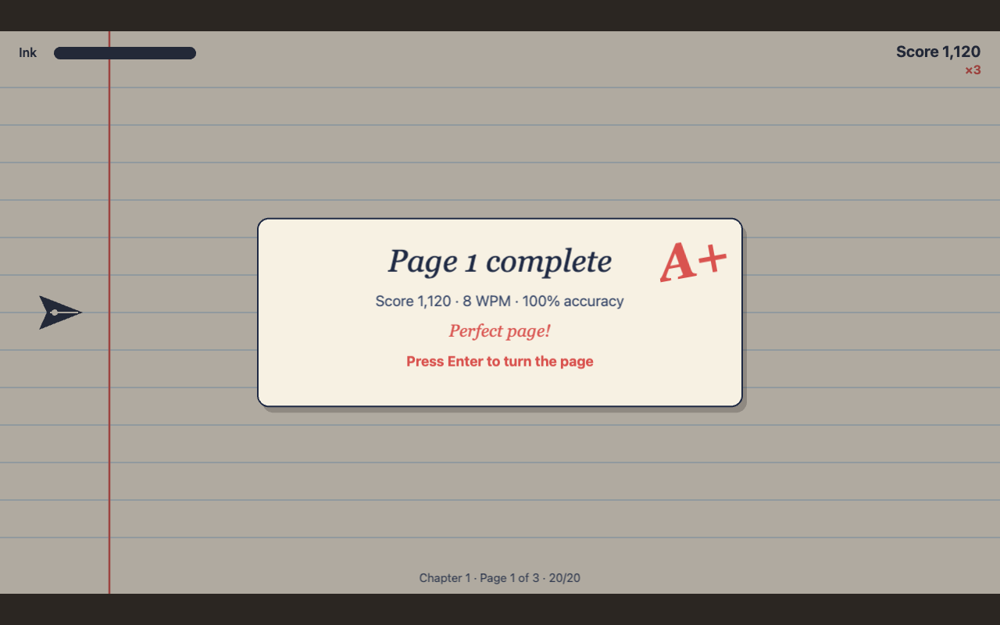 |  | 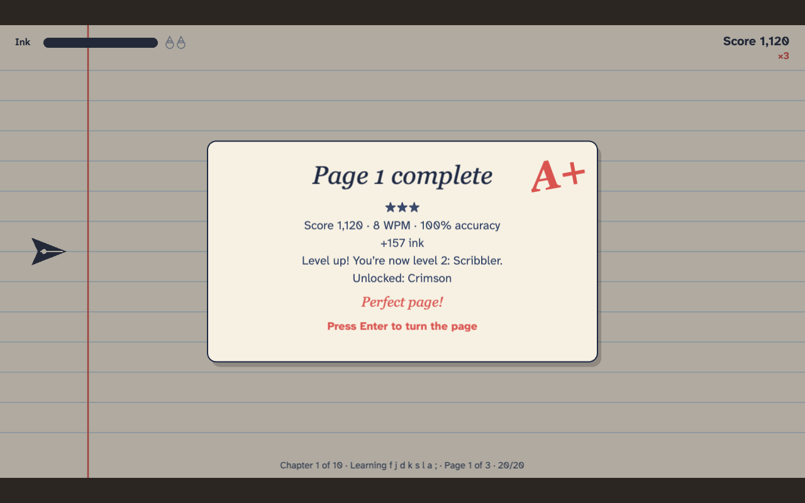 | 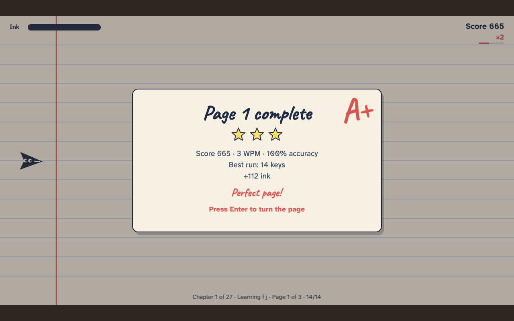 | 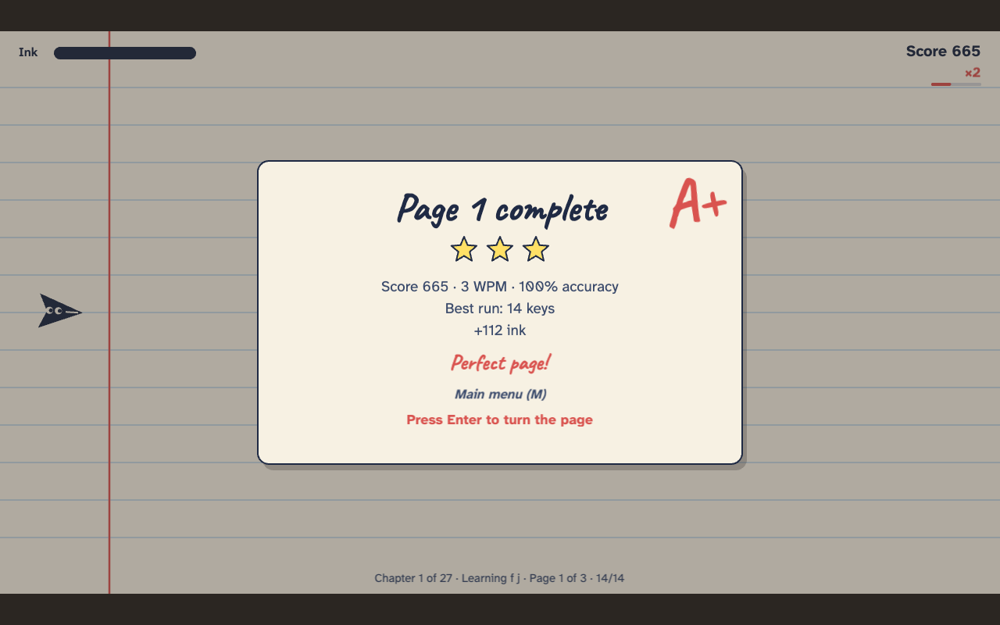 | 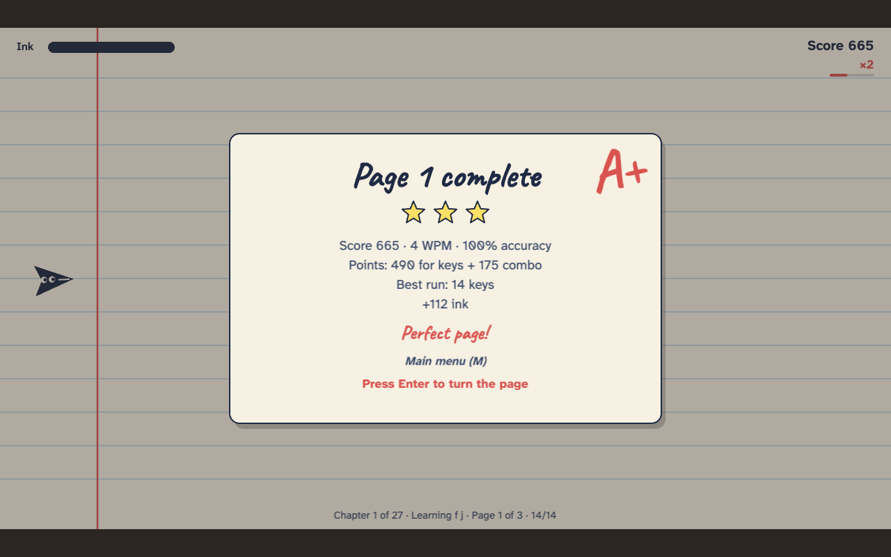 |
| Score, WPM and accuracy. | A **red-pen grade** and a teacher's note. | **Stars** (1 to 3). | **Ink** earned, level-ups and unlocks. | **Handwritten** title and grade, stars that fill in one by one, wrong keys and the best run. | A **Main menu (M)** link, so you can stop without starting the next page. | A **points** line: what came from the keys, the combo and the Highlighter. |

### Starting a chapter

| M12 | Latest |
|---|---|
|  |  |
| Chapter 1 of 10 teaches the whole home row at once, finger by finger. | Chapter 1 of 27 teaches just `f` and `j`, with a **hands guide**: the finger shaded, the key circled in red pen. |

### Settings and pause

| M7 settings | Latest settings | M9 pause | Latest pause |
|---|---|---|---|
|  |  |  | 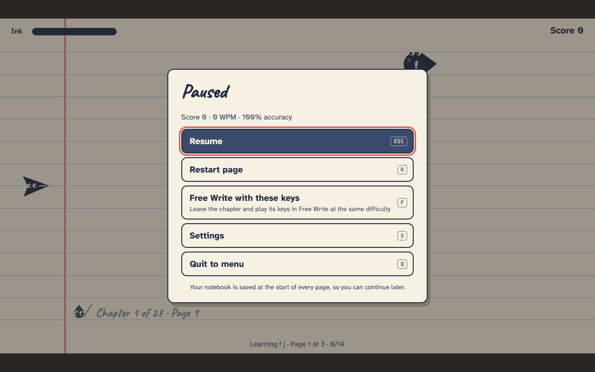 |
| Text size, colors, motion, sound. | The same options in the new font. | Resume, Restart page, Settings, Quit. | Adds **Free Write with these keys** (F; added in M14 as Practice these keys). |

## Milestone by milestone

### M1: Scaffold


The notebook page, the red margin, the Nib, and one placeholder creature drifting across. Underneath: Vite, TypeScript, PixiJS and a fixed-timestep game loop.

### M2: Core loop


**New:** typing. Letter drips stream in, the Nib locks onto the nearest match, misses drain the **ink** bar, and a combo multiplier builds your score. A start card and a "Page complete" card frame each page.

### M3: Word pages


**New:** Blotlings, word-carrying creatures. Words come from a bundled 56,000-word list, filtered to only the keys you're practicing, with a profanity guard. Pages alternate drips and Blotlings.

### M4: Chapters and difficulty


**New:** Relaxed, Normal, Hard and Expert, and a notebook made of chapters of pages, each a little harder. The footer shows chapter and page.

### M5: Type Case


**New:** pick exactly which keys to practice on a full keyboard. Click the top or bottom half of a key for its Shift or plain character. Presets (Home row, All letters, Code symbols…) and groups (left hand, top row…).

### M6: Saves and offline play

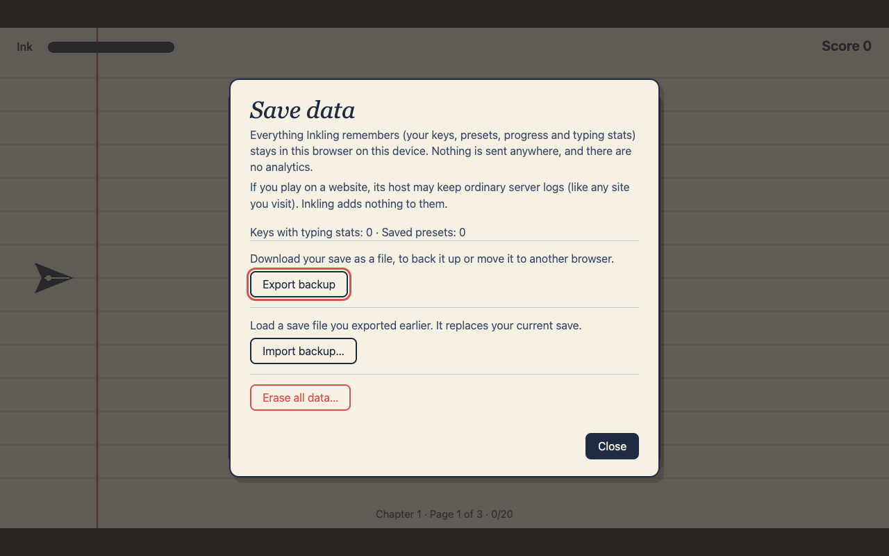

**New:** progress saved in the browser, with backups you can export and import. Works offline as an installable app. First deploy to GitHub Pages.

### M7: Grades, mastery, settings and sound


**New:** a red-pen grade on every page, mastery bars on the Type Case, a Settings dialog (text size, high contrast and night themes, motion, volume) and sound effects.

### M8: Run-ons, Misprints and word lists


**New:** Run-ons (phrases where mistakes stay until you Backspace them) and Misprints (typos you fix with the arrow keys). Tab switches targets. A Word lists dialog can download words about a topic you choose.


### M9: Menus


**Changed:** the start card becomes a **main menu** with a logo. **New:** a difficulty step before a new notebook, a pause menu (Resume, Restart page, Settings, Quit to menu) and How to play.

| New notebook | Pause |
|---|---|
|  |  |

### M10: Readability


**Changed:** every bit of text switches to the bundled Atkinson Hyperlegible fonts. Run-ons get shorter and arrive later.

### M11: Creatures


**Changed:** targets become creatures. Drips bob, Blotlings scurry on legs, Run-ons are centipedes, Misprints hop like stamps. Their eyes follow the Nib and they look worried near the margin. **New:** crimson (two words) and violet (three words) variants, and invisible-ink ghosts.

### M12: Apprentice campaign

| Contents | Chapter card |
|---|---|
| 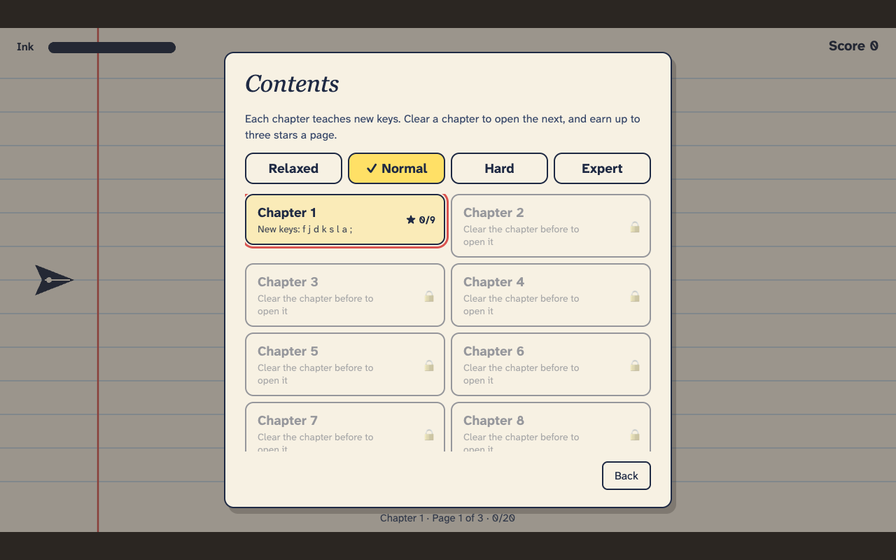 |  |

**New:** **Apprentice**, a 10-chapter course that teaches keys in order, with a card per chapter showing which finger types each new key. Pages earn 1–3 stars, and the Contents page shows them. **Practice** is the endless mode with your own keys.

### M13: Rewards

| Desk | Page with ink |
|---|---|
| 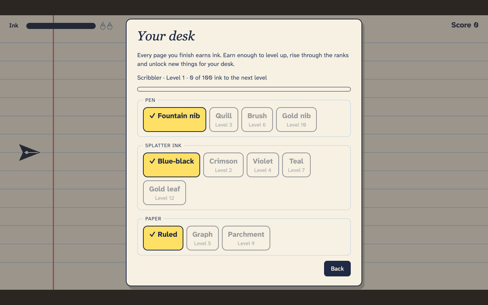 |  |

**New:** **ink** (experience) from every page, levels and ranks from Scribbler to Master Inkling, and a **Desk** to equip unlocked pens, splatter inks and paper. The Blotter power and the Spill boss arrive too. A playtest round after this rebuilt Apprentice for beginners (27 chapters, starting with `f` and `j`) and added ink shots from the Nib.

### M14: Players and creature looks

| Who's writing? | Desk |
|---|---|
|  | 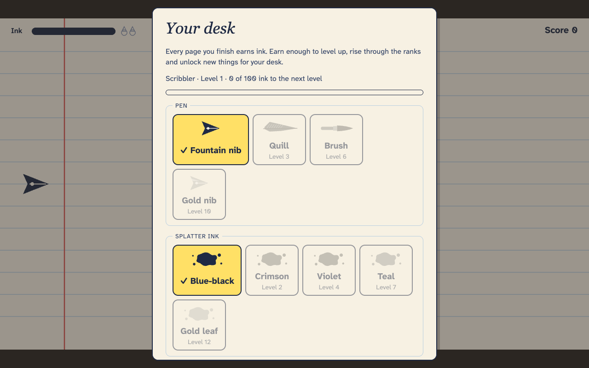 |

**New:** several players can share one browser, each with their own save. The Desk shows pictures of each pen and ink. Crimson and violet creatures get their own shapes (see the lineup above), and beaten creatures show x x eyes.

### After M14

| Chapter card | Type Case |
|---|---|
| 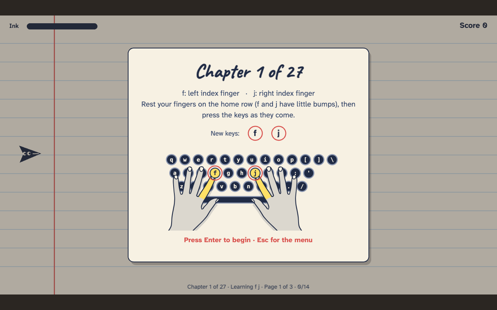 | 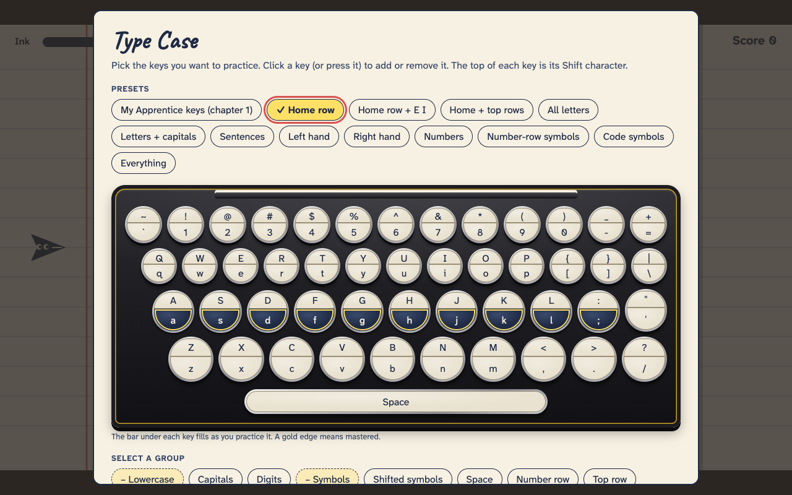 |

**New:** a per-player word filter (Family friendly, Older kids, Grown-ups), Blotlings from chapter 1 using made-up strings like `fjf`, the **hands guide** on chapter cards, and the **typewriter** Type Case. "Save data" became "Manage saves".

### M15: Character, consequences, powers and tips

| New on this page | A page in play |
|---|---|
| 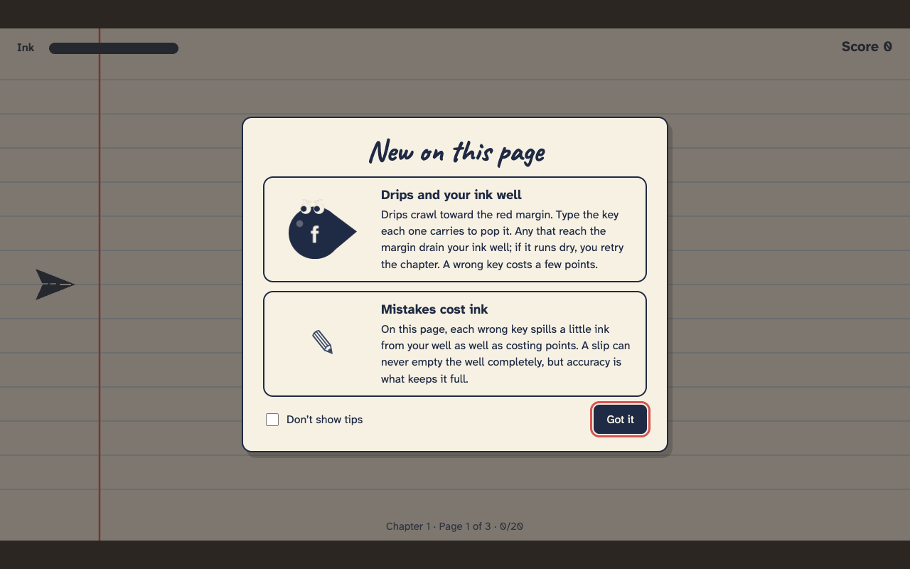 | 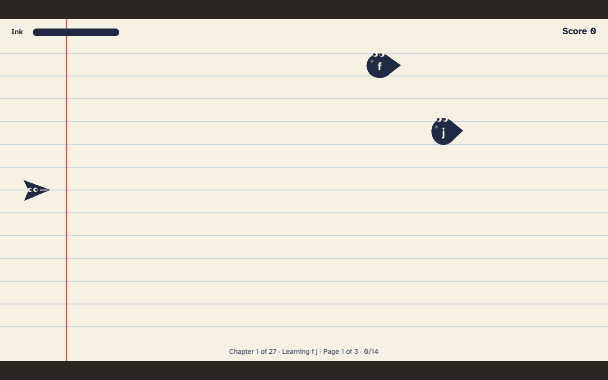 |

**New:**
- **Character:** the Nib has a face that blinks, winces, gasps and grins. Creatures pop and squash as ink lands, grin when you mistype, and jitter slightly like hand-drawn animation. Drips flick and Blotlings soak into the page when beaten. The locked creature gets a red-pen underline.
- **Feedback:** the page shakes and its edge flashes red when ink is lost, and throbs when ink is low. The score counts up, the multiplier kicks and falls away when a run breaks, and there are 11 new sounds.
- **Consequences and recovery:** wrong keys cost points and, further on, a little ink. Ink comes back from clean runs and from a rare ink bottle.
- **Powers:** charges earned by clean runs, harder to earn in later chapters. The Paperweight (↑), Highlighter (↓) and Blotter (Enter) spend them; the Eraser and Blotting paper work by themselves. They unlock over the Apprentice course or by level.
- **Tips:** a "New on this page" card before anything new, then a guided first try with a handwritten note. Tips can be turned off or reset in Settings.

**Changed:** headings, grades and notes use the handwritten Caveat font. A "Screen effects: Gentle" setting softens shake and turns off the red flash.

### M16: Keyboard layouts

| Settings | Chapter 1 on Dvorak | Type Case on Dvorak |
|---|---|---|
| 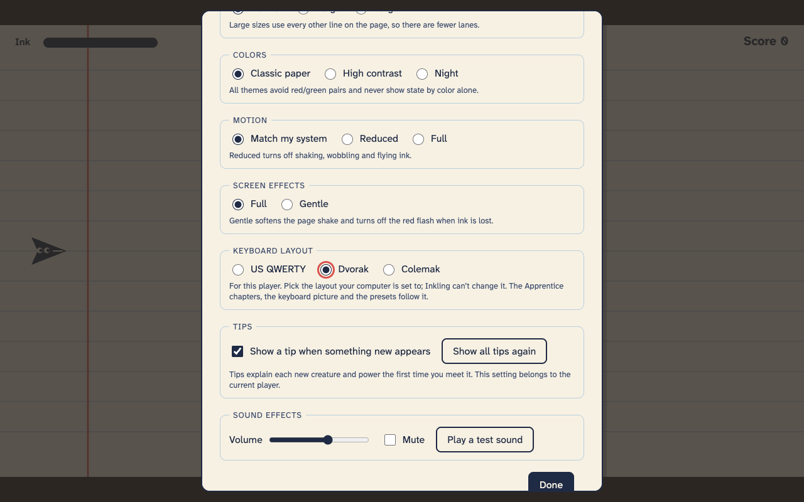 | 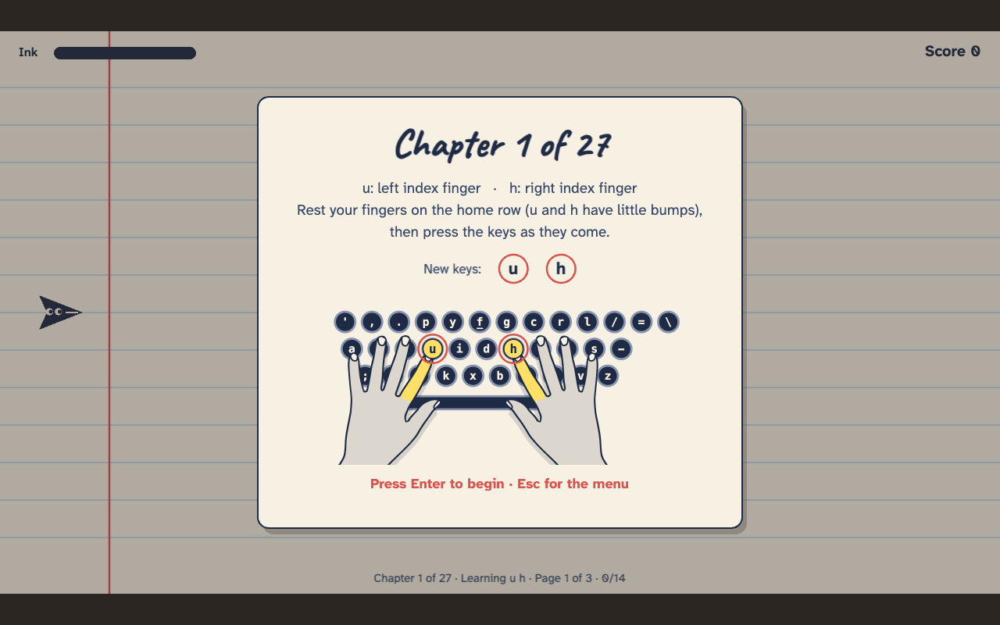 | 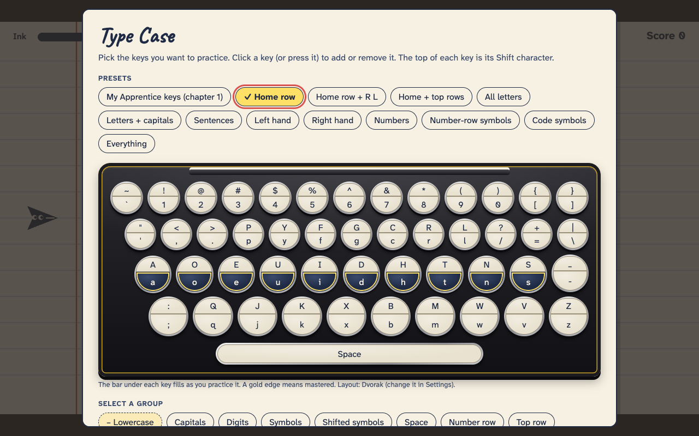 |

**New:**
- **Dvorak and Colemak** alongside US QWERTY. Each player picks a layout in Settings, and it's kept in their save (save version 8). Players from before M16 start on US QWERTY.
- The **Apprentice course follows the layout**. It starts on the index-finger home keys (F J, U H or T N), then the rest of the home row, then space and the other letters. Every layout has the same 27 chapters, so stars and progress stay put when a player switches.
- The Type Case keyboard, hands guide, finger hints, presets ("Home row", "Home row + E I / R L / U L") and "ready to learn" suggestions all use the player's layout. Switching layout carries a preset selection to the same preset on the new layout.

**Changed:** layouts are now built from one table of physical keys and fingering, with each layout giving only its characters (`src/content/layouts/`). On QWERTY, "ready to learn" now suggests keys in the Apprentice course's order, so E and I come after the home row rather than R and U.

### M17: First impressions

| Menu | How to play | Spacebar briefing |
|---|---|---|
| 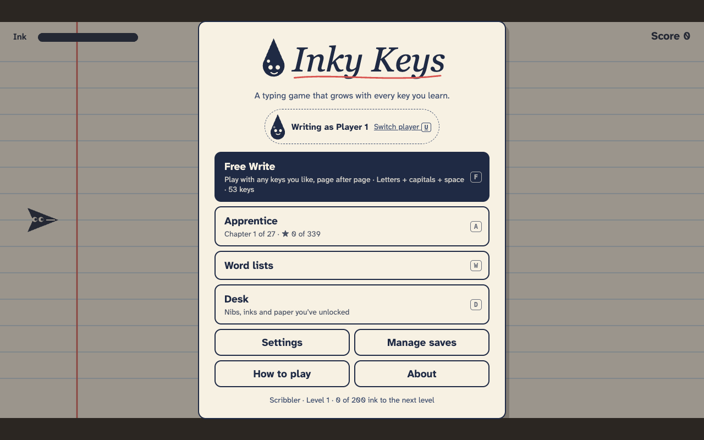 | 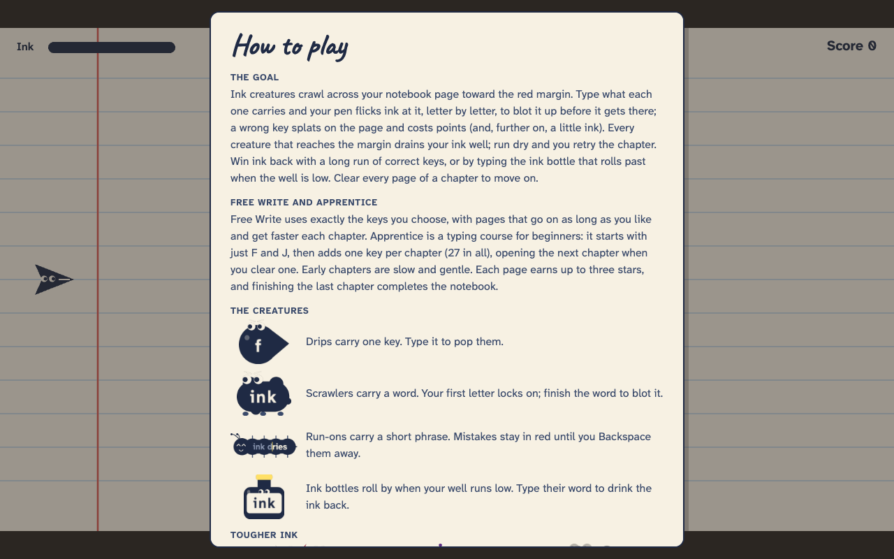 | 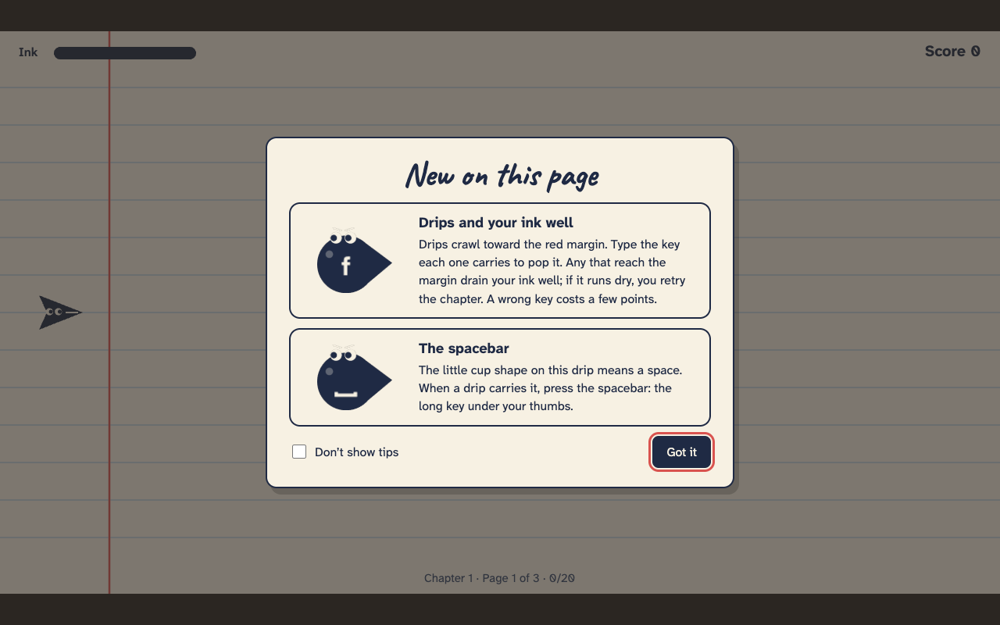 |

**New:**
- **Free Write** (formerly Practice) is first on the menu (F), and a new player starts on **Letters + capitals + space**, a new preset.
- A **spacebar briefing** the first time a page can show the ␣ mark, with a guided first space drip.
- **How to play** has pictures: each creature, the tougher inks, the Spill and the ink bottle, the player's keys on the hands guide, and key caps for the controls.
- The page-complete card has a **Main menu (M)** link.

**Changed:** **Misprints are gone** (the stamp creature, its briefing and the arrow-key editing), so the lineup ends with the Run-on. The yellow rings that marked ink coming back now hold for a moment and fade; before, they could get stuck on the ink bar until the screen was rebuilt.

### M18: Waves and pacing

No new screens this time: everything changed is in motion and in which pages come up, so there are no new shots.

**New:**
- **Zoom-in:** new creatures rush in from the right (up to 900 px/s), braking smoothly until their whole word is on the page, then crawl at their own pace. They never get closer than a small gap to the creature ahead in their lane.
- **Numbers and symbols get their own drip pages** in Free Write when the keys include at least three of them; letter drips never mix with them. With just one or two (like the home row's `;`), they stay mixed in as before.
- **Eraser grace:** for a second after the Eraser forgives a slip, further wrong keys are quietly ignored.

**Changed:**
- **Scrawlers are the main wave.** Free Write chapters are now mostly word pages with one letter-drip page (plus the symbols page, when there is one), and every chapter ends on words. Later Apprentice chapters are one drip page for the new key, then four word pages.
- **Charges are harder to earn on harder difficulties** (runs ×1.15 on Normal, ×1.35 on Hard, ×1.6 on Expert), and the **Blotter costs 3 charges on Hard and Expert** (still 2 on Relaxed and Normal).

### M19: Bosses

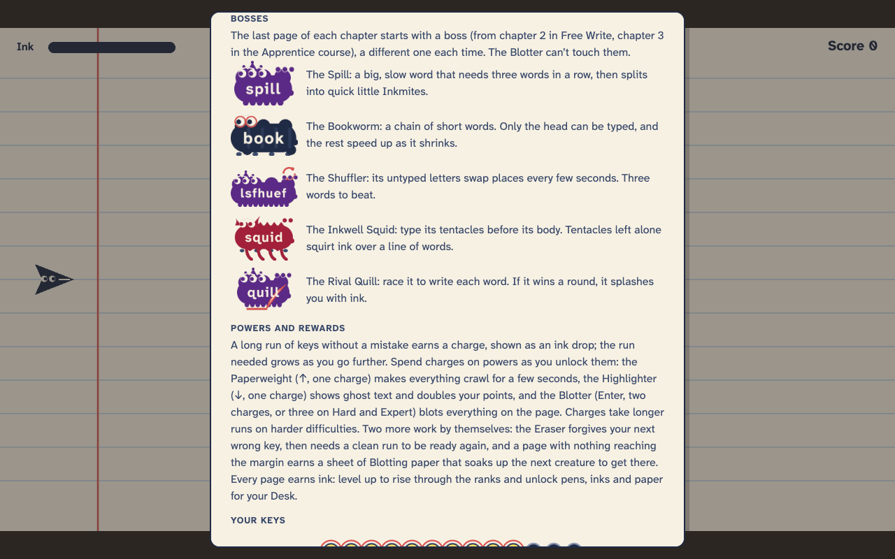

**New:** four bosses beside the Spill, taking turns on the last page of each chapter:
- **The Bookworm:** short-word segments in one line, joined by necks, wearing reading glasses. Only the head can be typed; the rest speed up as it shrinks.
- **The Shuffler:** red arrows chase round its back, and its untyped letters swap places every few seconds.
- **The Inkwell Squid:** a crimson body guarded by three curling tentacle words. Tentacles left alone squirt a band of ink that hides a line of words for a few seconds.
- **The Rival Quill:** a red race line and a quill run along under its word; if the quill gets to the end first, it splashes you with ink and starts a new word.

**Changed:** bosses arrive much sooner: from chapter 3 in the Apprentice course (was 7) and from chapter 2 in Free Write (which had none). Boss parts are sized and spaced in the core, so drawing and spacing agree. Also fixed: a key set of a single letter could freeze the game on a word page.

### M20: Score that matters

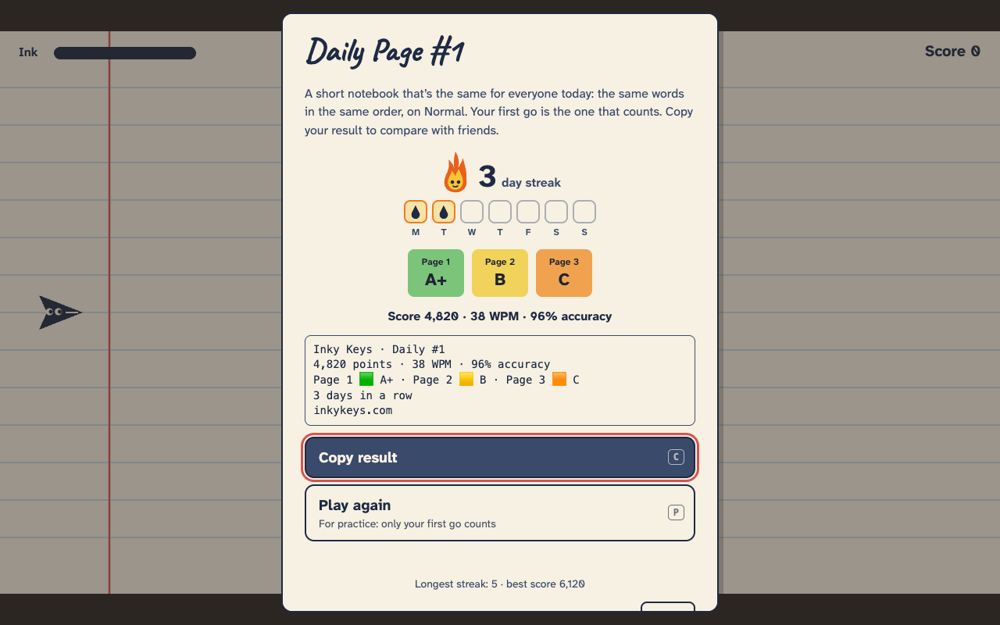

(The streak in this shot is sample data, filled in by the snapshot script.)

**New:**
- **The Daily Page** (T on the menu): a three-page notebook that's the same for everyone on a keyboard layout each day, always on Normal, ending with a boss that changes daily. Only the first go counts; later goes are practice, and Restart page is off on the counted one.
- **Streaks:** an ink drop that turns into a flame while a streak is going (and sleeps when it's broken), with this week's days filled in where you played.
- **Copy result:** a short text with the score, each page's grade and colour, and the streak, for pasting anywhere. Nothing is sent over the network.
- **Best score per page:** the graded page says "New best for this page!" or how far short you were, and Apprentice chapters show their best in Contents.

**Changed:** graded pages break the score down into points for keys, the combo and the Highlighter. Seeded pages draw each creature from its own stream, so how you play never changes what comes next (save version 9).

### M21: Stickers

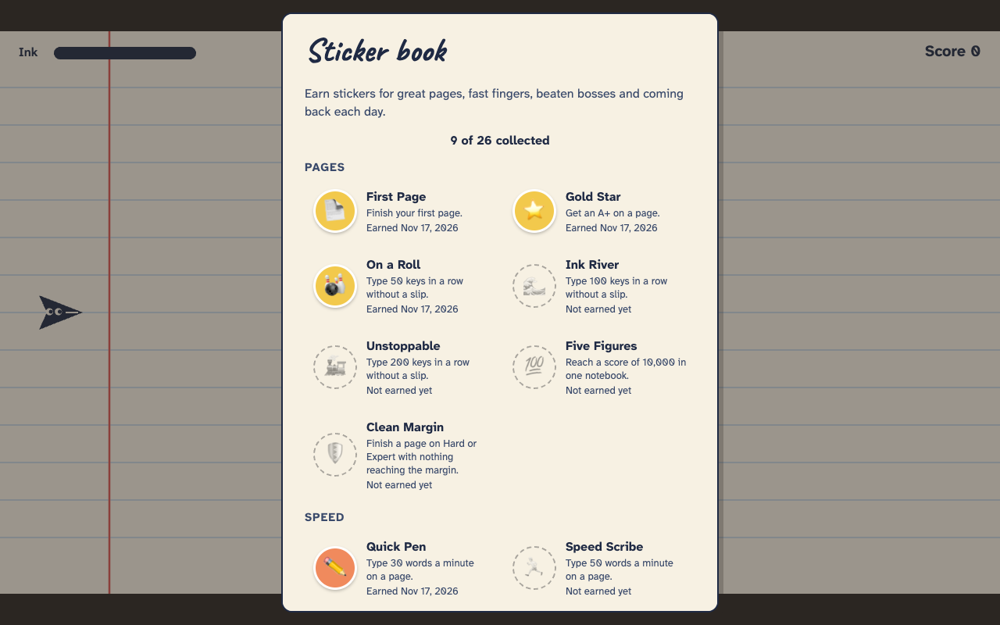

(The stickers in this shot are sample data, filled in by the snapshot script.)

**New:** a **sticker book** (K on the menu) with 26 stickers on six shelves:
- **Pages:** first page, an A+, runs of 50, 100 and 200 keys, 10,000 points in a notebook, a clean margin on Hard or Expert.
- **Speed:** 30, 50 and 70 words a minute on a page (with at least 60 keys typed).
- **Bosses:** the first boss, a spotless boss page, and all five kinds.
- **Apprentice and ranks:** every star in a chapter, halfway, graduating, and levels 5, 12 and 23.
- **Daily Page:** the first one, a perfect day, and 3, 7 and 30 days in a row.
- **Secrets:** two hidden ones, shown as "?" until earned.

Stickers arrive the moment they're earned, with a toast in the corner that doesn't stop play and a line on the page card. New ones are marked until the book is opened. Progress from before stickers existed (level, the Apprentice course) earns its stickers on the next visit (save version 10).

### M22: Challenges

| Challenge link | Daily Page |
|---|---|
| 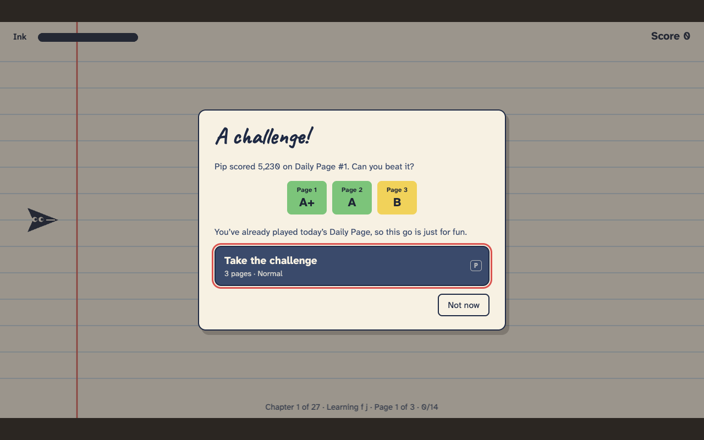 | 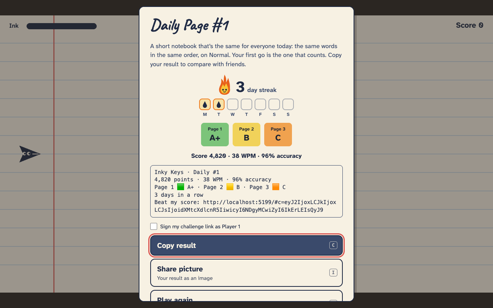 |
| Opening a friend's link. (Sample data from the snapshot script.) | The copied result now ends with a link, and there's a **Share picture** button. |

**New:**
- **Challenge links:** the copied Daily result ends with "Beat my score:" and a link. The part after `#` carries the day, layout, score and page grades (and the player's name only if they tick **Sign my challenge link**), and browsers never send it to the server. Opening one offers the same seeded notebook, with a **To beat** target at the top of the page that ticks once it's passed, and the result on the last card. Today's Daily Page still counts toward the streak if it hasn't been played.
- **Share picture:** the result drawn as a 1200 × 630 notebook page (score, WPM, accuracy, page tiles, the streak flame), sent to the system share sheet, the clipboard, or a saved file.

**Changed:** links are checked field by field; names are cut to letters, numbers and spaces and dropped if the word filter objects. PRIVACY.md says what links and pictures contain.

### M23: Transfer links

| Manage saves | Opening a transfer link |
|---|---|
| 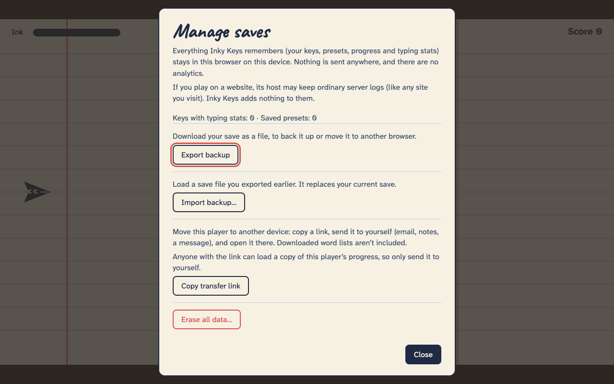 | 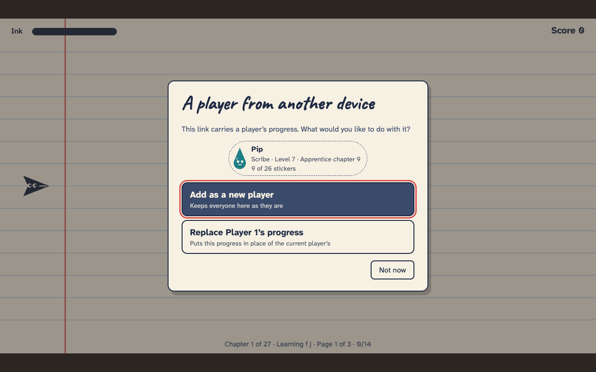 |
| A **Copy transfer link** row, with a warning to send it only to yourself. | Opening one. (Sample data from the snapshot script.) |

**New:** **transfer links** move a player to another device with no server. **Copy transfer link** in Manage saves compresses the player's name, badge and save (without downloaded word lists) into the part of a link after `#t=`, which browsers never send to the host. Opening it on the other device offers **Add as a new player** (numbered if the name is taken) or **Replace** the current player's progress, after a second confirmation. The save is checked just like an imported backup file; damaged links, saves from a newer version, and saves too big for a link each get a clear message.

## Keeping this up to date

At the end of each milestone, run:

```bash
npm run snapshots -- m23
```

That writes a standard set of shots to `docs/progression/m23/` (menu, desk, players, settings, settings-layout, type-case-dvorak, chapter-intro-dvorak, how-to-play, how-to-play-bosses, daily, stickers, challenge, practice, type-case, briefing, lineup, pause, contents, chapter-intro, play, page-done). Then:

1. Run `npm run snapshots -- latest` too, so the "Latest" column matches.
2. Add a section under **Milestone by milestone** with one or two shots and what's **New** or **Changed**.
3. If the milestone visibly changes a screen in **Side by side**, add a column there. If it adds a new screen, add a step to `TOUR` in `scripts/snapshots.ts` so later milestones capture it as well.
4. Commit only the shots the page uses, to keep the repo small.

The script runs the Vite dev server and headless Chrome (set `CHROME_PATH` if Chrome isn't found) and needs Node 22 or later.
